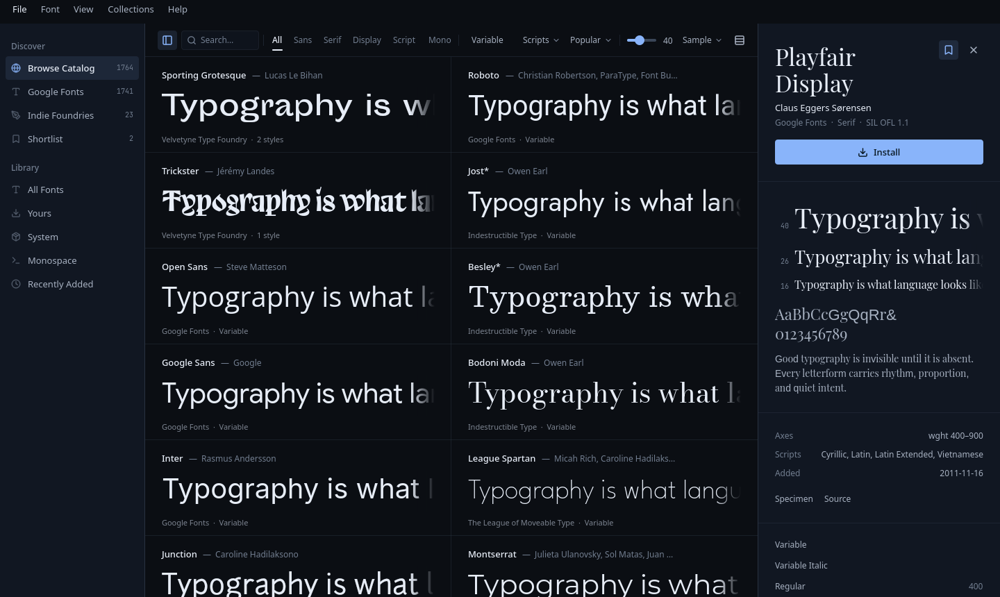

# Omatype

[](https://ko-fi.com/pipetogrep)

An open-source font browser and manager for Omarchy — bringing an Adobe Fonts-style discovery and one-click installation workflow to Linux design tools like FigCraft and ArtCraft.

Browse open-source type catalogs (Google Fonts and curated open-source foundries) with live previews, designer attribution, shortlisting, weight management, and one-click installation without juggling zip files — alongside full local font management, deactivation, collections, and specimen views.



## Discover & One-Click Install

Omatype brings an **Adobe Fonts-style discovery experience** to Linux and Omarchy — no zip files, no manual extracting:

- **Google Fonts (1,740+ families)** indexed live with 24-hour local caching, plus **23 curated indie open-source typefaces** from **Velvetyne Type Foundry**, **Indestructible Type**, **The League of Moveable Type**, **Vercel (Geist)**, **GitHub Next (Monaspace)**, **Nerd Fonts**, and independent designers.
- **Instant live previews** — streams tiny 3–12 KB subsetted TrueType previews on demand and caches them in `~/.cache/omatype/previews/` so scrolling through thousands of typefaces stays fast and responsive.
- **Type-first browsing** — custom editable sample text with typographic presets (*Editorial*, *Pangram*, *Figures*, *Alphabet*, *Paragraph*), adjustable preview size, grid or full-width rows, and filters for category, variable fonts, writing systems and sort order. Tabs that do not fit beside the detail panel fold behind a **…** button.
- **Designer attribution & provenance** — every detail view credits the type designer(s), foundry/source, license (SIL OFL 1.1 / Apache 2.0), variable axes, scripts, and links to the upstream specimen and repository.
- **Suitcase-style Shortlist** — bookmark candidates while exploring, then open **Shortlist** in the sidebar and click **Install all** to install the set in one go.
- **Granular weight management** — one-click install the variable font (recommended) or select individual static weights. Fonts install cleanly to `~/.local/share/fonts/<Family>/` alongside their license file and automatically refresh `fc-cache`.
- **Apps see new fonts straight away** — register the applications you set type in (FigCraft, ArtCraft, Inkscape, GIMP, Krita, LibreOffice, a browser) under **Tools ▸ Applications**, and Omatype restarts them after an install so the new font is in their menus. See [Applications](#applications).

## Install

### The app

```sh
sudo pacman -S --needed base-devel git
git clone https://github.com/pipetogrep/omatype.git ~/omatype
cd ~/omatype
./bin/install
```

`./bin/install` builds an Arch package with `makepkg` and installs `omatype`
to `/usr/bin`, with a desktop entry and icon, so it shows up in the app
launcher. To try it without installing, run `./bin/build` and then
`./build/omatype`. `./bin/test` runs the offscreen Qt Test suite, and
`./bin/screenshots` captures the website screenshots at 2× from your own fonts,
in the Catppuccin theme unless you pass `--theme <name>` (or `--theme current`).

Update later with `git pull && ./bin/install`.

### Omarchy bar widget (optional)

Omatype also comes as a bar widget for Omarchy's shell, `pipetogrep.omatype`:
an **Aa** button whose popup searches the catalog, installs fonts in one click
and lists installed families. **It is a separate plugin.** Installing or
running the app does not put anything in your bar; add the widget yourself:

```bash
omarchy plugin add https://github.com/pipetogrep/omatype.git --enable
```

The widget runs the `omatype` command, so install the app first (above). If
it cannot find it, the popup says *Omatype binary not found*. It looks on your
`PATH`, then in `~/.local/bin`, then for a `build/omatype` inside the plugin
folder (`~/.config/omarchy/plugins/pipetogrep.omatype`).

Click **Aa** to open the popup; **middle-click** opens the full window. Toggle
it from a keybinding with `omarchy-shell pipetogrep.omatype toggle`, or move
it with `omarchy bar move pipetogrep.omatype --section right`. Update it with
`omarchy plugin update pipetogrep.omatype`.

### Uninstall

```bash
omarchy plugin disable pipetogrep.omatype   # the bar widget, if you added it
omarchy plugin remove pipetogrep.omatype
sudo pacman -Rns omatype                     # the app, if installed with ./bin/install
```

Your installed fonts in `~/.local/share/fonts/` are left untouched. To also
remove Omatype's settings and caches:

```bash
rm -rf ~/.config/omatype ~/.cache/omatype
```

### Command line

The same engine works headlessly without a window:

```bash
omatype search "Playfair"                    # search Google Fonts & indie foundries
omatype search --source indie                # browse curated indie foundries
omatype get "Space Grotesk"                  # 1-click install (variable font + OFL.txt + fc-cache)
omatype get "Inter" --static                 # install static weights instead of variable
omatype list                                 # installed families, yours first (--all includes language fonts)
omatype info Inter                           # styles, designer, licence, glyph count, files
omatype install ~/Downloads/Pack.zip         # install local files, folders or archives
omatype remove "Playfair Display"
omatype validate ~/Downloads/Pack/*.ttf      # or a family name
omatype deactivate "Noto Sans Tamil"
omatype activate "Noto Sans Tamil"
omatype export Inter ~/Desktop/inter-files
```

Add `--json` to any command for scripting.

## The window

Omatype has two modes, picked in the sidebar: **Discover** (`Ctrl+G`) browses
the open-source catalogs, and **Library** (`Ctrl+Shift+L`) manages the fonts
on your machine. The panel on the right shows the selected family in both;
drag its left edge to resize it (double-click to reset). The **View** menu
follows the mode: in Discover, Grid and List switch the catalog layout,
Bigger and Smaller change the preview size, and Sort by lists the catalog
orders.

**Sidebar** — where the families come from. Under Discover: Browse Catalog,
Google Fonts, Indie Foundries, Shortlist and Installed. Under Library: All
Fonts, Yours, System, Starred, Monospace, Recently Added, Deactivated,
Duplicates; then your tags, collections and smart collections. Each Library
source expands to list its families (hover a row for the chevron). `Ctrl+B`
hides the sidebar.

**The refine row**, under the toolbar, narrows whatever source is showing:
design tabs (Serif, Sans-serif, Handwriting, Ornamental, Symbolic, Monospace,
Variable, Colour glyphs, worked out from the files themselves), then a
**Scripts** menu (Latin, Greek, Cyrillic, Arabic, Devanagari…) and a
**Languages** menu. **Clear** resets all three. Tabs that do not fit fold
behind a **…** button.

**The list** shows the families of the chosen source, split into **Yours**,
the ones in your font folder that you can remove, and **System**, which belong
to packages. Starred families float to the top. Each family is set in its own
typeface. An `M` marks a monospace family, a star a starred one, a crossed eye
a deactivated one, a double square one with duplicate faces. **View ▸ Sort
by** orders them by name, date added, number of styles or foundry.

**Families, not weights.** Older font packs name every weight as its own
family, so a plain font list shows Acme Sans, Acme Sans Black, Acme Sans Bold,
Acme Sans Book and more as separate entries. Omatype folds them into one
family, Acme Sans, with Black, Bold and Book among its styles. The Info pane says which names
were folded in. Turn it off under **View ▸ Group weights into one family** if
you prefer the raw names.

**Language fonts are hidden by default.** A typical Arch install carries around
300 Noto families, one per writing system, which buries the forty or so fonts
you would ever deliberately choose. They stay installed; they are just folded
out of the way. The toolbar says how many are hidden and unfolds them, and
typing a filter searches all of them regardless. Your own fonts never fold.

**The view** in the middle has five modes, in the toolbar or `Ctrl+1` to `5`:

| View | Shows |
|---|---|
| Specimen | The name at display size, the sample line at five sizes, the character set |
| Grid | Every family as a card with a big "Ag" in its own face |
| List | A table: family, styles, kind, foundry, where it lives, its state |
| Repertoire | Every character the face covers, with code points. Click one to add it to the sample |
| Compare | Up to six families stacked, the same sample line in each. `Ctrl+M` adds or removes the selected family |

The sample line is editable, because a font is chosen against the words it
will actually set. The slider, or `Ctrl` `+` and `−`, changes the type size
(in Discover, the preview size).

**The Info pane** on the right starts with your own marks: a star, tags, and a
note. Then it reads the font files themselves: kind, version, PostScript and
unique names, glyph count, units per em, weight, width, traits, embedding
permissions, design class, designer, manufacturer, foundry, trademark,
copyright, licence, description, the languages and writing systems it covers.
Then the styles, each in its own face with its own deactivate switch; the
files on disk, with when and from what they were installed; the collections
it belongs to; and the actions.

## Tags, stars and notes

A **tag** is an adjective: `display`, `body`, `code`, a client, a licence.
Type it into the Info pane; existing tags autocomplete. Tags appear in the
sidebar with counts, click one to filter, and `#display` in the search box
finds them too. Right-click a tag in the sidebar to rename it everywhere or
remove it. A **star** (`Ctrl+S`) floats a family to the top of every list and
gives it a sidebar source of its own. A **note** is free text per family: why
you have it, where it is licensed, what it is for.

## Search

The filter box searches names by default: family, style, PostScript and full
names. The chevron picks another scope:

- **Designer or foundry** — who made it, from the file's own name table.
- **Supports these characters** — type the characters a font must have, for
  instance `ẞ` or `→`, and only families that cover them are listed.
  fontconfig answers this one, so it is exact.

## Installing fonts

| How | What happens |
|---|---|
| Drop a file, folder or archive on the window | Everything installable inside it is staged |
| **File ▸ Install from Disk**, the folder button in the toolbar, or `Ctrl+O` | Same, through the desktop file chooser |
| Open a font file from your file manager | Opens Omatype with that font staged |
| `omatype ~/Downloads/Pack.zip` | Same, from a terminal |

Staged fonts are **validated and previewed before anything is written**. The
Info pane lists every family and face it is about to install, marks the ones
with problems, and says where they will go. A face with serious problems is
left out unless you tick "install anyway"; minor findings are reported and
installed. **Report** shows the full validation report.

If a file is already in place you choose what happens: **Replace** it, **Skip**
it, or **Keep both** (the new copy gets a `-2` suffix).

A downloaded family is rarely one file, so a folder or an archive installs
whole. Zips, tarballs and 7z all work. Packs often ship the same faces as both
OTF and TTF; when that happens you get a choice, because the two formats
frequently disagree about family names and cannot be merged reliably.

Fonts land in `~/.local/share/fonts/<Family>/` (or under `$XDG_DATA_HOME` if
you have set it). No password is needed.

**Applications already running will not see a new font until they restart.**
That is fontconfig, not Omatype. Apps opened afterwards pick it up straight
away. Register the apps you use under [Applications](#applications) and
Omatype restarts them for you.

## Applications

Most applications read the font list once, when they start. **Tools ▸
Applications** lists the apps installed on your machine, running ones first,
along with the ones that set type: design tools, word processors, editors,
browsers and terminals. **Register** the ones you use. After every install
Omatype restarts the registered apps that are running, so the new font is in
their menus. Apps are asked to quit, never killed, so one with unsaved work
can still ask you to save. Turn
**Auto** off for an app to get a **Reload** button instead. **Add custom**
registers anything else, by process name, launch command or your own reload
command (for instance `pkill -USR1 kitty`).

## Deactivating fonts

**Deactivate** (`Ctrl+D`) hides a family from every application without
touching its files. System fonts included: a package's font can be switched
off for your account and switched back on later. The crossed-eye button on a
single style deactivates just that face, which is how you resolve a duplicate.
Deactivated fonts stay in the list, struck through, and under **Deactivated**
in the sidebar. **Activate** brings them back.

Behind it is one fontconfig file, `~/.config/fontconfig/conf.d/60-omatype-deactivated.conf`,
which Omatype writes and removes. Nothing else is changed.

## Duplicates

The same family and style in two files is a duplicate: one copy wins at render
time and nobody chose which. **Duplicates** in the sidebar lists the families
affected, the Info pane marks the faces, and deactivating or removing one copy
resolves it.

## Collections

A **collection** is a set of families you pick by hand: use the **Collections**
section of the Info pane, or **Font ▸ Add to collection**. A collection can be
**activated or deactivated as a whole**, so a project's fonts can be the only
ones switched on while you work, and **exported** to a folder, one subfolder
per family, to hand to a client. Right-click it in the sidebar.

A **smart collection** is a set of rules: family name, style, PostScript name,
designer, manufacturer, kind, language, writing system, design class, trait,
tag, location or weight, each with *contains*, *begins with*, *ends with*,
*is* or *is not*, matching all or any. Right-click one in the sidebar to edit,
rename or delete it.

## Tidy up

**Tools ▸ Tidy up** (`Ctrl+Shift+T`) lists what is worth cleaning, each with a
fix: the same styles installed as both OTF and TTF (keep one format), static
weights sitting beside a variable font (keep the variable font), files that
fail validation, fonts of yours that set no Latin text, and how much the
language-coverage families take up. Package copies are only ever deactivated.
Anything that would delete your own files asks first and lists them.

## Removing, exporting, validating

- **Remove** (`Delete`) asks first, then deletes a family's files from your
  own font folder and prunes the empty folder. System fonts cannot be removed from here; deactivate
  them instead.
- **Export** (`Ctrl+E`) copies a family's files to a folder you choose.
- **Validate** (`Ctrl+Shift+V`) checks every file of a family: the table
  directory, required tables, glyph count, names, the character map, the
  embedding flags, and whether the font engine can load it.
- **Show in file manager** opens the folder the files live in.
- **Save as PDF** writes a family's specimen, waterfall or repertoire, ready
  to print.

## Setting your terminal font

Select a monospace family and click **Set as Terminal font** or press `Ctrl+T`. This
hands off to Omarchy's own `omarchy-font-set`, so your terminal configs and
the monospace alias are updated the way Omarchy expects. The button only
appears on a machine that has that tool.

## Keyboard

| Key | Does |
|---|---|
| `Ctrl+G` | Discover: browse the open-source catalogs |
| `Ctrl+Shift+L` | Library: your installed fonts |
| `Ctrl+O` | Install fonts from a file, folder or archive |
| `Enter` | Install what is staged |
| `Esc` | Clear the stage, then the filter |
| `/` | Filter the families |
| `↑` `↓` `Home` `End` `PgUp` `PgDn` | Move through the list |
| `Delete` | Remove the selected family (yours only) |
| `Ctrl+S` | Star or unstar the selected family |
| `Ctrl+M` | Add the selected family to Compare, or take it out |
| `Ctrl+D` | Deactivate or activate the selected family |
| `Ctrl+E` | Export the selected family's files |
| `Ctrl+Shift+V` | Validate the selected family |
| `Ctrl+P` | Save a specimen PDF |
| `Ctrl+T` | Set the selected monospace family as the terminal font |
| `Ctrl+1` … `Ctrl+5` | Specimen, Grid, List, Repertoire, Compare |
| `Ctrl+Shift+T` | Tidy up |
| `Ctrl` `+` / `−` / `0` | Bigger, smaller, actual size (Library type or Discover previews) |
| `Ctrl+B` | Show or hide the sidebar |
| `Ctrl+L` | Show or hide the language-coverage fonts |
| `Ctrl+R` | Rescan |
| `?` | Keyboard shortcuts |
| `Ctrl+Q` | Quit |

## Requirements

- **Runtime:** Qt 6 (`qt6-base`, `qt6-declarative`, `qt6-svg`), `fontconfig`, `libarchive`, `hicolor-icon-theme`, and an XDG desktop portal (`xdg-desktop-portal`) for the file choosers. All of these are included on every Omarchy install.
- **Omarchy bar widget:** Omarchy Quattro (`omarchy-shell` / Quickshell).
- **Build:** `base-devel` (`gcc`, `make`, `pkgconf`) and `git`.

## What Omatype writes

| Where | What |
|---|---|
| `~/.local/share/fonts/<Family>/` | Fonts you install (or under `$XDG_DATA_HOME/fonts`) |
| `~/.config/omatype/library.json` | Your collections, smart collections, tags, stars, notes and registered applications |
| `~/.config/omatype/omatype.conf` | Window settings: view, sort order, sample text, panel width |
| `~/.cache/omatype/` | The Google Fonts index and preview fonts; safe to delete |
| `~/.config/fontconfig/conf.d/60-omatype-deactivated.conf` | The deactivated fonts; removed when nothing is deactivated |

Nothing outside your home folder is touched, and no password is needed for
anything but installing the app itself.

## Support

**Help ▸ About Omatype** links to [omatype.com](https://omatype.com), the
source and Ko-fi. Omatype is free and open source. If it saves you time, you can support its
development on [Ko-fi](https://ko-fi.com/pipetogrep).

## Attribution

Omatype is forked from [OmaFont](https://github.com/28allday/omafont-app), originally created by **Gavin Nugent** under the MIT License. All original copyright notices and attribution are preserved in [LICENSE](LICENSE).

## Licence

MIT. Icons are from [Lucide](https://lucide.dev), ISC.
